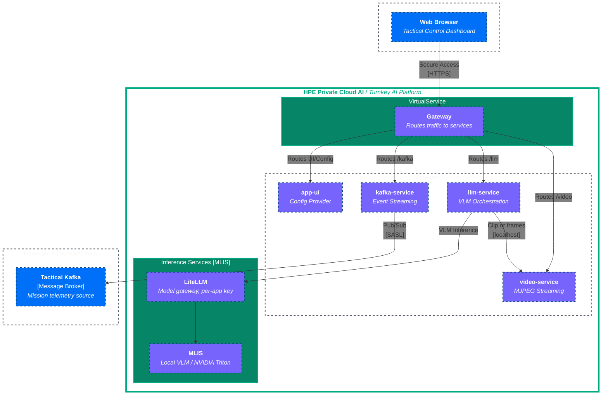

# Defence-Ops Architecture Diagram

This document provides a high-level overview of the **Defence-Ops** microservices architecture, illustrating the connections between services, external providers, and the user request flow.

## System Architecture
 

## Service Responsibilities

### 🖥️ app-ui
- **Frontend**: A Next.js-powered dashboard providing a "Global Tactical Operations Room" experience.
- **Admin Configuration**: Manages demo settings (model, Kafka broker and topic) via `/api/v1/admin/demo-config`. Only PCAI administrators can change them; the app verifies their Keycloak sign-in token.
- **Persistence**: Saves and loads system configuration from a shared JSON file on a Persistent Volume. It holds no secrets.

### 🤖 llm-service
- **Tactical Chat**: Handles user queries and merges them with Kafka tactical context and the selected feeds.
- **Models**: Lists the models the app's LiteLLM key may use, with what each accepts (vision, video, thinking).
- **Visual Context**: Sends video-capable models one short clip of the feeds, other vision models still frames, and falls back to frames if a model refuses video.
- **Thinking**: Switches on the model's own reasoning when asked and supported, and returns it separately from the answer.

### 📡 kafka-service
- **SSE Streaming**: Provides a Server-Sent Events (SSE) endpoint at `/api/v1/kafka/stream` for real-time dashboard updates.
- **Alert Generation**: Simulations or actual production of tactical alerts to the Kafka cluster.
- **Telemetry**: Consumes raw mission data and exposes it to the UI.

### 🎥 video-service
- **Video Processing**: Serves four independent MJPEG streams representing tactical feeds.
- **VLM Readiness**: Extract sequence frames from video feeds for Vision Language Model analysis in the `llm-service`.

## Request Flow Example: Tactical Analysis

1.  **User** asks a question in the chat about "Tactical 1" feed.
2.  **app-ui** sends the prompt, the feed names and recent alerts (from **kafka-service**) to **llm-service**.
3.  **llm-service** reads the selected model from the shared configuration and checks what it accepts.
4.  **llm-service** asks **video-service** for a short clip (video models) or still frames (other vision models).
5.  **llm-service** calls the model through **LiteLLM** with the app's own key.
6.  The answer, and the model's reasoning if thinking was on, is returned to the user via the dashboard.
