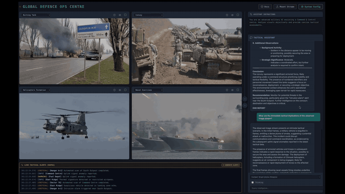
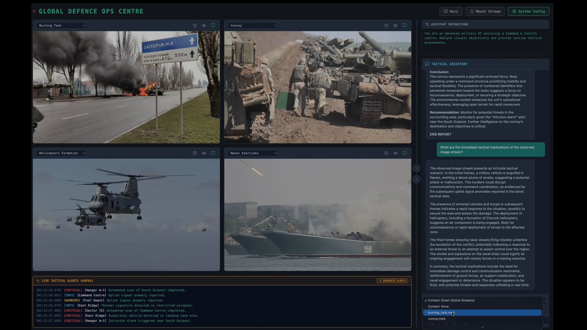
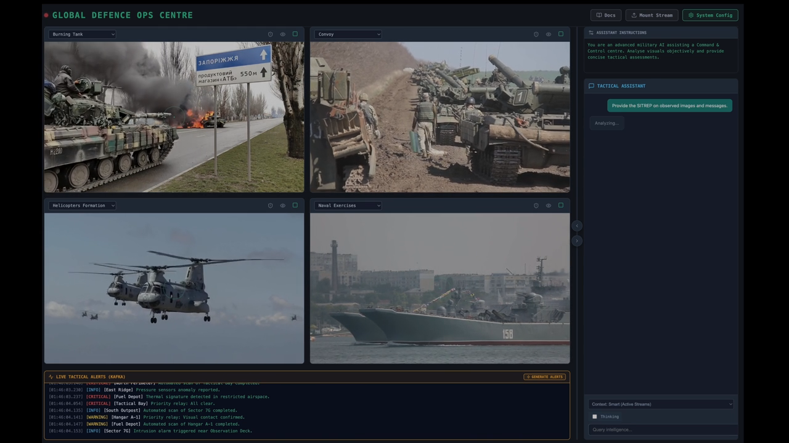
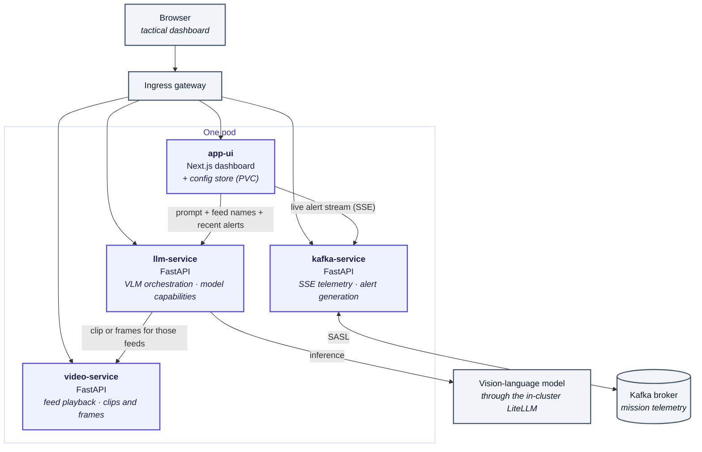

# Defence-Ops — a tactical operations centre with a vision model in the loop

> **Prerequisites** — requires [HPE Private Cloud AI](https://www.hpe.com/us/en/hpe-private-cloud-ai.html).

An operations centre watches more video than anyone can actually watch. **Defence-Ops**
is a demo of what changes when a vision-language model watches it with you: four live
feeds in a grid, a telemetry ticker alongside them, and an assistant that answers
questions about *what is on screen right now* — "how many vehicles are in this
convoy?", "give me the SITREP across all feeds" — instead of about a document
someone wrote earlier. Every part of it runs on infrastructure you control: the model
endpoint is one you configure, the video never leaves your cluster, and there is no
external AI service in the path. It is built as a reference for anyone evaluating
private, on-premises AI for work where the footage cannot go to a public API — and as
a concrete example of wiring a multimodal model to real-time streams rather than to a
chat box.



<table>
<tr>
<td width="50%"></td>
<td width="50%"></td>
</tr>
<tr>
<td><em>The model's assessment cites what it can see in the frames it was given.</em></td>
<td><em>"Smart Context" sends frames from every playing feed plus recent telemetry in one question.</em></td>
</tr>
</table>

## How it works

Four services, each doing one job, running as four containers in one pod
(`deployment/defence-ops`), each on its own port behind one Service: `app-ui` 3000,
`kafka-service` 8001, `llm-service` 8002, `video-service` 8003. Models come from the
cluster's LiteLLM proxy through the app's own key. The UI saves the configuration
(model, Kafka broker and topic) to `config.json` on the `app-data` volume, and the
other services read it from there. Secrets are not part of it: the LiteLLM key and
the Kafka credentials are Kubernetes Secrets that only llm-service and kafka-service
read, and only PCAI administrators can change the configuration.



A question travels: the UI sends the question, the names of the feeds in context and
the latest telemetry to `llm-service`. That service checks what the selected model
accepts, as LiteLLM declares it: video-capable models get one short Motion-JPEG clip
of the feeds, other vision models still frames, and a model that refuses video gets
frames from then on. Thinking mode is switched on only for models that support it, and the model's
reasoning comes back separately from the answer. The model is told which images show
which feed, and fixed operating rules come ahead of the operators' own instructions:
answer only from the imagery and alerts supplied, separate what is observed from what
is assessed, keep a concise military register, and give no targeting details. The
**Generate Alerts** button writes sample alerts about the feeds in the grid, so the
ticker and the imagery tell one story. [DIAGRAM.md](./DIAGRAM.md) has the
detailed version.

| Service | Stack | Responsibility |
|---|---|---|
| `app-ui` | Next.js 16, React 19 | Dashboard, admin, and the shared configuration store |
| `video-service` | FastAPI | Feed playback, uploads, clips and frames for inference |
| `llm-service` | FastAPI | Prompts, model capabilities and vision-language inference via LiteLLM |
| `kafka-service` | FastAPI | Live alerts over Server-Sent Events, sample alerts matched to the feeds |

## What you need

- **[HPE Private Cloud AI](https://www.hpe.com/us/en/hpe-private-cloud-ai.html)**,
  which supplies the cluster, the model-serving endpoints and the ingress, with
  `kubectl` and `helm` configured against it.
- **A vision-language model** behind the cluster's LiteLLM proxy, and a LiteLLM key
  for this app, stored as Secret `defence-ops-litellm` (key `api-key`) in the app's
  namespace. The model must accept images, not just text.
- **Capability flags on each model in LiteLLM.** Models don't report what they accept
  through LiteLLM, and LiteLLM only knows that for models in its own catalogue. So set
  `supports_vision`, `supports_video_input` and `supports_reasoning` in each model's
  **Model Info** (LiteLLM UI: Models + Endpoints → model → Edit Settings). Unset flags
  mean frames and no thinking mode. Through LiteLLM only vLLM-served models (MLIS
  Nemotron VL) take a video clip; for Ollama models LiteLLM itself rejects video, so set
  `supports_video_input: false` there.
- *Optional:* a Kafka broker for live telemetry. Without one the dashboard runs on
  generated alerts, which is enough to demo it.

Private Cloud AI is what this demo is built and verified against. Nothing in the
chart is hard-wired to it, so it will also install on a plain Kubernetes cluster
with your own ingress and an OpenAI-compatible vision endpoint — that path just
is not the supported one.

## Deploy it

```bash
kubectl create namespace defence-ops

helm install defence-ops ./helm \
  --namespace defence-ops \
  --set ezua.virtualService.endpoint=defence-ops.<YOUR_DOMAIN>

kubectl get pods -n defence-ops -w
```

`ezua.virtualService.endpoint` is the hostname the ingress will answer on; the chart
uses it for both the route and the auth policy. The app is then at
`https://defence-ops.<YOUR_DOMAIN>`.

On HPE Private Cloud AI you can instead use its **Import Framework** wizard, which
takes a packaged chart and a logo: give it `defence-ops-<version>.tgz` and
`defence-ops.png`, and a namespace.

### First run

As a PCAI administrator, open **System Config** in the navigation bar and set:

| Setting | Value |
|---|---|
| Model | A **vision** model from the list LiteLLM offers this app's key |
| Kafka *(optional)* | Broker (`host:port`) and topic |

The Kafka credentials are Secret `defence-ops-kafka` (keys `username` and `password`)
for a user limited to that stream. Everyone else sees System Config read-only.

Then pick a feed in any grid cell and press play. First load of each video is slow
while it is fetched and cached; after that it is instant.

- The **eye** icon asks what objects are in the scene; the **shield** icon scans for
  threats. Both are one-click prompts.
- The chat box takes anything else. Choose **Smart Context** to ask across every
  playing feed plus recent telemetry, or scope it to one feed. **Thinking** mode
  shows the model's reasoning before its answer.

[USAGE.md](./USAGE.md) is the full walkthrough; [EXAMPLES.md](./EXAMPLES.md) has
questions that demo well.

## Development

The Tiltfile targets the lonpcai cluster:

```bash
KUBECONFIG=~/.kube/lon-master.yaml tilt up --context lonpcai
```

Tilt builds the four images, pushes them to Harbor (`registry.nxsg.co.uk/dev`) and runs
the pod in namespace `dev` at `https://defence-ops-dev.demo.lon-pcai.twlon.com`, with
live reload and without SSO. Stop it with `tilt down --context lonpcai`. The Tiltfile
refuses to deploy into `defence-ops`: a Tilt run there on 2026-05-29 took over the
Import Framework release's Services and, after the release's next upgrade, left the app
with no endpoints from 24 October to 2 November 2026.

To publish images, sign in to Docker Hub as `erdincka` and pass the version. The script
pushes only that tag; `latest` stays on the 1.0.x multi-pod images.

```bash
docker login -u erdincka
./scripts/publish_images.sh 1.2.1
```

Then set `global.image.tag` in `helm/values.yaml`.

Each Python service is a uv project (`pyproject.toml`, `uv.lock`) with its own tests;
run them in a container, never on the workstation, for example:

```bash
docker run --rm -v "$PWD":/work -w /work/llm-service python:3.12-slim sh -c 'pip install -q uv==0.13.6 && UV_PROJECT_ENVIRONMENT=/tmp/venv uv run --frozen pytest -q'
```

### Releasing on lonpcai

The Import Framework app is EzAppConfig `defence-ops-0.0.1-1774573363791`; its job runs
`helm upgrade` from the platform chartmuseum with the record's `chartVersion` and
`values`. The Secrets `defence-ops-litellm` and `defence-ops-kafka` must exist in the
namespace first; the 1.2.0 rollout steps are in `~/Applications/lonpcai/defence-ops/README.md`.

1. Publish the images with the release tag (above).
2. Package the chart: `helm package helm -d dist`.
3. Upload it to the chartmuseum (a protected namespace, so the cluster owner does this):
   ```bash
   kubectl --context lonpcai create --raw /api/v1/namespaces/ez-chartmuseum-ns/services/chartmuseum:8080/proxy/api/charts -f dist/defence-ops-0.2.1.tgz
   ```
4. Point the record at the new version. The values set the endpoint and the Keycloak
   issuer, so that `${DOMAIN_NAME}` is substituted in both:
   ```bash
   kubectl --context lonpcai patch ezappconfig defence-ops-0.0.1-1774573363791 --type merge \
     -p '{"spec":{"chartVersion":"0.2.1","values":"ezua:\n  virtualService:\n    endpoint: \"defence-ops.${DOMAIN_NAME}\"\n    istioGateway: \"istio-system/ezaf-gateway\"\nsettings:\n  oidc:\n    issuer: \"https://keycloak.${DOMAIN_NAME}/realms/UA\"\n"}}'
   ```
5. Check: the record shows `ready` with health `ok`, and `deployment/defence-ops` in
   `defence-ops` is 4/4 ready.

**Roll back:** patch `chartVersion` back to the previous version, which stays in the
chartmuseum.

## Provenance, and a note on the sample videos

This demo was developed as part of my work at HPE, and the sample footage in
`assets/videos/` is included here under HPE's rights to redistribute it.

That permission does not extend to you. The clips remain third-party copyrighted
material: you may run them as part of this demo, but **not** reuse them in your
own products or redistribute them separately — see
[assets/videos/README.md](./assets/videos/README.md). For your own deployment,
substitute your own material; `video-service` picks up any `.mp4` or `.mov`
dropped in that directory, no configuration needed.

## Licence

The code, configuration and documentation here are MIT — see [LICENSE](./LICENSE).
The sample footage in `assets/videos/` and `demo.mp4` is **excluded** from that
grant and stays under the terms above.

---

Demonstration software. Not a targeting system, not an operational tool, and not
built or validated for real-world military use.

© 2026 HPE. For demonstration purposes only.
